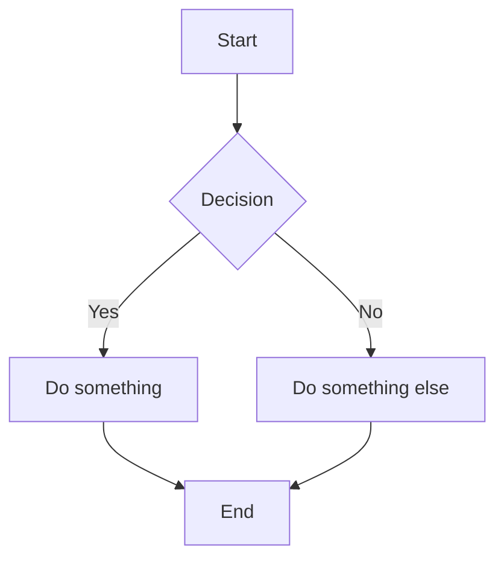
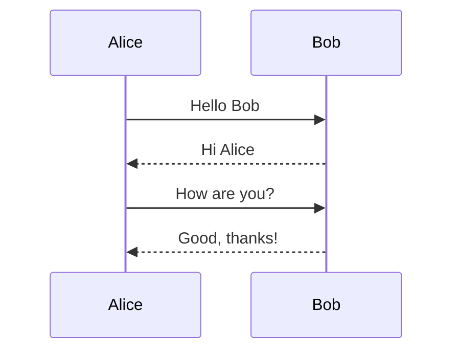
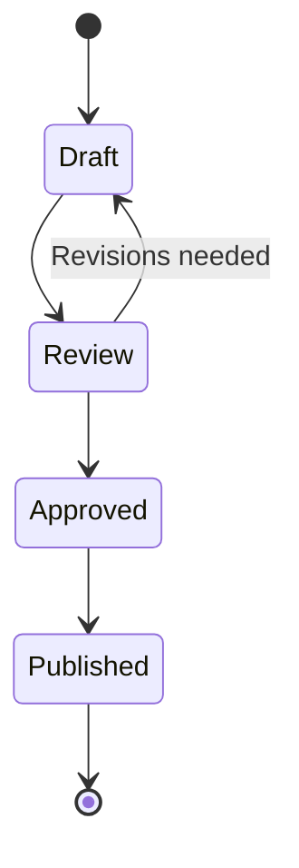

# Mermaid Diagrams

## Flowchart



## Sequence Diagram



## State Diagram



## Regular Code Block (should remain as CodeNode)

```javascript
const x = 42;
console.log(x);
```

## Text After Mermaid

This paragraph follows the mermaid diagrams to verify nothing breaks the document flow.
